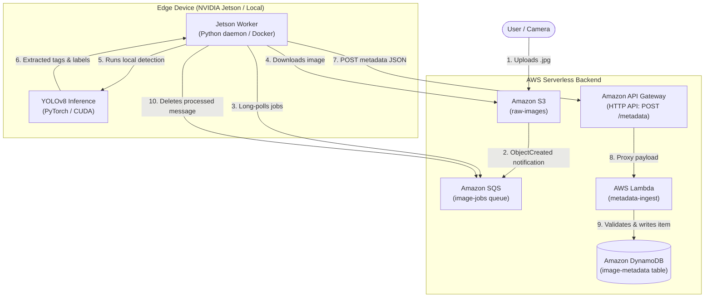

# Cost-Optimized Edge AI Processing Pipeline

> **NVIDIA Jetson + AWS Serverless Architecture**  
> An event-driven, cost-conscious pipeline that processes wildlife and fine art imagery using local edge GPU inference (YOLOv8) coupled with a fully serverless AWS cloud backend. Runs at **$0–$3/month** at demo scale.

---

## 📑 Table of Contents

- [Overview](#-overview)
- [Architecture & Data Flow](#-architecture--data-flow)
- [Repository Structure](#-repository-structure)
- [Prerequisites](#-prerequisites)
- [Setup Guide](#-setup-guide)
  - [1. Package the Lambda Function](#1-package-the-lambda-function)
  - [2. Deploy Infrastructure with Terraform](#2-deploy-infrastructure-with-terraform)
  - [3. Configure the Edge Worker](#3-configure-the-edge-worker)
- [Execution](#-execution)
  - [Option A: Run Locally via Python (Development & Testing)](#option-a-run-locally-via-python-development--testing)
  - [Option B: Run on NVIDIA Jetson via Docker (Production Edge GPU)](#option-b-run-on-nvidia-jetson-via-docker-production-edge-gpu)
- [End-to-End Verification](#-end-to-end-verification)
- [Running Tests](#-running-tests)
- [Architecture & Design Decisions](#-architecture--design-decisions)
- [Cost Analysis](#-cost-analysis)
- [Security Model](#-security-model)
- [Failure Modes & Resiliency](#-failure-modes--resiliency)
- [Production Roadmap](#-production-roadmap)
- [Teardown & Cleanup](#-teardown--cleanup)

---

## 🚀 Overview

This project demonstrates how to bridge resource-constrained edge computing with modern serverless cloud infrastructure while maintaining extreme cost efficiency.

Key capabilities:
1. **Event-Driven Image Ingestion**: Automated notification triggers when images land in Amazon S3.
2. **Decoupled Job Queue**: Amazon SQS acts as a buffer, preventing runaway costs and enabling edge devices to process at their own pace or recover from network outages.
3. **Edge GPU Inference**: Local YOLOv8 object detection on an NVIDIA Jetson (or local device), eliminating recurring cloud GPU costs (e.g., EC2 `g4dn` / `p3` instances).
4. **Automated Metadata Generation**: Enriched metadata (tags, dynamic titles, and descriptive captions) generated directly at the edge.
5. **Serverless Storage**: RESTful API Gateway endpoint backed by AWS Lambda to validate and record structured metadata into Amazon DynamoDB.

---

## 🏗 Architecture & Data Flow



### Flow Breakdown

1. **Upload**: A `.jpg` image is uploaded to the S3 bucket (`edge-ai-phedit-demo-raw-images`).
2. **Notify**: An S3 bucket notification automatically sends an `s3:ObjectCreated:*` message containing the bucket and object key to the SQS queue.
3. **Poll**: The edge worker long-polls SQS (`WaitTimeSeconds: 10`) for incoming jobs.
4. **Download**: The worker fetches the image directly from S3 into a local working directory (`/tmp`).
5. **Inference**: Ultralytics YOLOv8 runs GPU-accelerated object detection and extracts identified classes/tags.
6. **Enrich**: The worker constructs a structured JSON record (`id`, `name`, `title`, `description`, `tags`).
7. **Ingest**: The edge worker POSTs the record to API Gateway (`POST /metadata`).
8. **Store**: AWS Lambda validates the payload and commits the item to DynamoDB (`image-metadata`).
9. **Acknowledge**: Upon a successful HTTP 200 response, the edge worker deletes the message from SQS to finalize processing.

---

## 📁 Repository Structure

```
.
├── README.md                           # Project documentation
├── aws-infra/
│   └── terraform/                      # Infrastructure as Code (Terraform)
│       ├── apigateway.tf               # API Gateway HTTP API configuration
│       ├── dynamodb.tf                 # DynamoDB metadata table
│       ├── iam.tf                      # Lambda execution & IAM policies
│       ├── lambda.tf                   # Lambda function deployment
│       ├── outputs.tf                  # Stack outputs (queue URL, bucket, API endpoint)
│       ├── provider.tf                 # AWS provider configuration
│       ├── s3.tf                       # S3 raw image storage + event notification
│       ├── sqs.tf                      # SQS queue & queue policies
│       ├── variables.tf                # Project input variables
│       └── versions.tf                 # Terraform version constraints
└── jetson-ai-worker/
    ├── Dockerfile                      # Container for NVIDIA Jetson (PyTorch/CUDA)
    └── app/
        ├── main.py                     # Edge worker entrypoint
        ├── worker.py                   # SQS polling, S3 download, API dispatch
        ├── inference.py                # YOLOv8 inference wrapper
        ├── config.py                   # YAML configuration loader & env overrides
        ├── config.yaml                 # Runtime settings (queue URL, API endpoint, thresholds)
        ├── logging_config.py           # Logging formatter setup
        ├── requirements.txt            # Python dependencies
        ├── models/
        │   └── yolov8n.pt              # Pre-trained YOLOv8 nano model
        ├── tests/                      # Worker unit tests (pytest + pytest-mock)
        └── lambda/
            ├── handler.py              # AWS Lambda metadata ingestion handler
            ├── lambda.zip              # Pre-packaged Lambda deployment archive
            └── tests/                  # Lambda unit tests
```

---

## ⚙️ Prerequisites

Before you begin, ensure you have the following installed and configured:

- **AWS Account** with administrative or appropriate IAM permissions for S3, SQS, API Gateway, Lambda, DynamoDB, and IAM.
- **[AWS CLI](https://aws.amazon.com/cli/)** installed and configured (`aws configure`).
- **[Terraform](https://www.terraform.io/)** (>= v1.0.0).
- **Python** (3.10 or 3.11) and `pip`.
- **For Edge Deployment**:
  - NVIDIA Jetson device (Orin, Xavier, or Nano) with JetPack installed and NVIDIA Container Runtime enabled.
  - *OR* any standard Linux/macOS/Windows workstation for local simulation (CPU or CUDA).

---

## 🛠 Setup Guide

### 1. Package the Lambda Function

Terraform packages the Lambda function from `jetson-ai-worker/app/lambda/lambda.zip`. A pre-built archive is tracked in the repository, but if you modify `handler.py`, rebuild the zip archive:

```bash
cd jetson-ai-worker/app/lambda
zip -j lambda.zip handler.py
cd ../../../
```

### 2. Deploy Infrastructure with Terraform

Initialize and apply the Terraform configuration to provision all AWS resources:

```bash
cd aws-infra/terraform

# Initialize Terraform providers
terraform init

# Review execution plan
terraform plan

# Apply infrastructure changes
terraform apply
```

When prompted, confirm with `yes`. After the apply finishes, Terraform outputs the provisioned resource identifiers:

```text
Apply complete! Resources: 14 added, 0 changed, 0 destroyed.

Outputs:

api_endpoint  = "https://<api-id>.execute-api.us-east-1.amazonaws.com"
s3_bucket     = "edge-ai-phedit-demo-raw-images"
sqs_queue_url = "https://sqs.us-east-1.amazonaws.com/<account-id>/edge-ai-phedit-demo-queue"
```

> [!NOTE]
> Keep these outputs handy. You will paste them into the worker configuration in the next step.

### 3. Configure the Edge Worker

Edit `jetson-ai-worker/app/config.yaml` to match your Terraform outputs:

```yaml
app:
  name: jetson-ai-worker
  environment: dev
  log_level: INFO

aws:
  region: us-east-1   # Match your terraform aws_region

  sqs:
    queue_url: https://sqs.us-east-1.amazonaws.com/<account-id>/edge-ai-phedit-demo-queue
    wait_time_seconds: 10
    max_messages: 1

  s3:
    bucket_name: edge-ai-phedit-demo-raw-images
    download_dir: /tmp

  api:
    endpoint: https://<api-id>.execute-api.us-east-1.amazonaws.com/metadata
    timeout_seconds: 5

inference:
  model_path: /app/models/yolov8n.pt   # Path to YOLO weights (or local relative path)
  device: cuda                        # Use "cuda" for GPU or "cpu" for local CPU testing
  confidence_threshold: 0.25
  iou_threshold: 0.45
  max_detections: 20

worker:
  delete_message_on_success: true
  retry_on_failure: false
  sleep_seconds: 1
```

> [!TIP]
> If testing locally on a computer without an NVIDIA GPU, set `device: cpu` and adjust `model_path` to `./models/yolov8n.pt`.

---

## 💻 Execution

You can run the edge worker either directly via Python or inside a Docker container.

### Option A: Run Locally via Python (Development & Testing)

1. Navigate to the worker directory:
   ```bash
   cd jetson-ai-worker/app
   ```

2. Create and activate a Python virtual environment:
   ```bash
   python3 -m venv venv
   source venv/bin/activate
   ```

3. Install required dependencies:
   ```bash
   pip install --upgrade pip
   pip install -r requirements.txt
   ```

4. Set your AWS environment credentials (if not using `~/.aws/credentials`):
   ```bash
   export AWS_ACCESS_KEY_ID="your-access-key-id"
   export AWS_SECRET_ACCESS_KEY="your-secret-access-key"
   export AWS_DEFAULT_REGION="us-east-1"
   ```

5. Start the worker:
   ```bash
   python3 main.py
   ```

You will see logging output indicating the worker is long-polling SQS for incoming jobs:
```text
2026-11-15 12:00:00 [INFO] app: Starting Jetson Edge Worker
2026-11-15 12:00:10 [INFO] worker: SQS response: {'Messages': []...}
```

---

### Option B: Run on NVIDIA Jetson via Docker (Production Edge GPU)

The project includes a `Dockerfile` based on NVIDIA's official PyTorch Jetson container (`nvcr.io/nvidia/pytorch:24.08-py3-igpu`).

1. Navigate to the worker root:
   ```bash
   cd jetson-ai-worker
   ```

2. Build the Docker image:
   ```bash
   docker build -t jetson-ai-worker .
   ```

3. Run the container with NVIDIA runtime access:
   ```bash
   docker run -d \
     --name jetson-worker \
     --runtime nvidia \
     --restart unless-stopped \
     -e AWS_ACCESS_KEY_ID="your-access-key-id" \
     -e AWS_SECRET_ACCESS_KEY="your-secret-access-key" \
     -e AWS_DEFAULT_REGION="us-east-1" \
     jetson-ai-worker
   ```

4. Check logs:
   ```bash
   docker logs -f jetson-worker
   ```

---

## 🧪 End-to-End Verification

Once both the cloud infrastructure and edge worker are active, verify the pipeline end-to-end:

### 1. Upload a Test Image to S3

Upload any sample `.jpg` image to your raw images bucket:

```bash
aws s3 cp jetson-ai-worker/app/models/bus.jpg s3://edge-ai-phedit-demo-raw-images/bus.jpg
```

### 2. Observe the Worker Logs

Within seconds, the worker receives the SQS notification, downloads the image, executes inference, and sends the metadata:

```text
[INFO] worker: Downloading edge-ai-phedit-demo-raw-images bus.jpg /tmp/bus.jpg
[INFO] inference: Detected labels: {'bus', 'person'}
[INFO] worker: Metadata string: {"id": "018e4...", "name": "bus.jpg", "title": "Bus", "description": "A fine art wildlife photograph featuring bus, person.", "tags": ["bus", "person"]}
[INFO] worker: Posting metadata for bus.jpg
[INFO] worker: Successfully processed bus.jpg
```

### 3. Verify DynamoDB Metadata Entry

Query or scan the DynamoDB table to verify that the record was created:

```bash
aws dynamodb scan --table-name image-metadata --output json
```

You should see an item matching your processed image:

```json
{
  "Items": [
    {
      "id": { "S": "019318b7-..." },
      "name": { "S": "bus.jpg" },
      "title": { "S": "Bus" },
      "description": { "S": "A fine art wildlife photograph featuring bus, person." },
      "tags": { "L": [{ "S": "bus" }, { "S": "person" }] },
      "created_at": { "S": "2026-11-15T12:00:15.123456" },
      "request_id": { "S": "c8a14352-..." }
    }
  ],
  "Count": 1
}
```

---

## 🚦 Running Tests

Unit tests are included for both the edge worker and the Lambda function.

### Worker Tests

Tests worker message handling, configuration parsing, and inference wrappers:

```bash
cd jetson-ai-worker/app
pytest tests/
```

### Lambda Handler Tests

Tests payload validation, DynamoDB insertion mocks, and HTTP status code responses:

```bash
cd jetson-ai-worker/app/lambda
pytest tests/
```

---

## 💡 Architecture & Design Decisions

| Decision | Alternative Considered | Rationale |
| :--- | :--- | :--- |
| **Amazon SQS Queue** | Direct S3-to-Lambda trigger | Prevents runaway concurrency costs. If hundreds of images arrive at once, SQS absorbs the burst while the edge worker pulls at its own processing rate. Enables offline resilience. |
| **Edge GPU Inference** | AWS EC2 / SageMaker GPU instances | Eliminates heavy recurring cloud GPU costs ($100–$500+/mo for running EC2 GPU instances 24/7). Leverages existing edge hardware for near-zero operational cost. |
| **API Gateway HTTP API** | Edge direct write to DynamoDB | Clean service boundary and perimeter defense. Edge credentials only need read access to S3/SQS and write access to an HTTP endpoint, rather than direct DynamoDB permissions. Allows future JWT/API key authentication. |
| **DynamoDB On-Demand** | Provisioned Capacity (RCU/WCU) | Pay-per-request pricing means zero cost when no images are processed, while handling burst traffic automatically without capacity planning. |

---

## 💰 Cost Analysis

Designed for extreme cost optimization:

| Service | Tier / Usage Pattern | Monthly Cost (Demo Scale) |
| :--- | :--- | :--- |
| **Amazon S3** | Standard storage (< 5 GB raw photos) | ~$0.10 – $0.50 |
| **Amazon SQS** | Long polling (~1M requests within Free Tier) | $0.00 |
| **AWS Lambda** | 1M free requests / month (Free Tier) | $0.00 |
| **Amazon API Gateway** | HTTP API (1M free requests / month for 12 mos) | $0.00 |
| **Amazon DynamoDB** | On-Demand (25 GB free storage & free tier units) | $0.00 |
| **Amazon CloudWatch** | Logs retention capped at 7 days | < $1.00 |
| **Edge Compute (Jetson)**| Local electricity & pre-existing hardware | ~$0.50 (power) |
| **Total Estimated Cost**| | **<$3.00 / month** |

> [!TIP]
> Set AWS Billing budget alerts at **$10** and **$20** thresholds to catch accidental runaway costs.

---

## 🔐 Security Model

- **Least-Privilege IAM**: Edge credentials only require `s3:GetObject` on the raw images bucket and `sqs:ReceiveMessage` / `sqs:DeleteMessage` on the queue.
- **No Direct Database Access**: The edge device cannot access or mutate DynamoDB directly.
- **Network Boundaries**: All communication with AWS services uses HTTPS (TLS 1.2/1.3).
- **Log Retention**: CloudWatch logs expire after 7 days to eliminate storage bloat and log accumulation costs.

---

## 🚨 Failure Modes & Resiliency

- **Edge Device Goes Offline**: Images uploaded to S3 continue to generate SQS messages. The queue safely holds messages up to its retention period (default 4 days). When the Jetson reconnects, it resumes processing the backlog without data loss.
- **Inference Failure / Crash**: If the worker crashes while processing an image, the message is not deleted from SQS. Once the visibility timeout expires (60 seconds), the message returns to the queue for retry.
- **Missing or Invalid Image in S3**: The worker logs an exception and gracefully handles file read issues without hanging the polling loop.
- **API / Lambda Ingestion Failure**: If API Gateway or DynamoDB rejects the metadata payload (HTTP 4xx or 5xx), the worker raises an exception and skips SQS message deletion, preserving the job.

---

## 📈 Production Roadmap

Future enhancements for enterprise/production deployments:

- [ ] **Dead-Letter Queue (DLQ)**: Add an SQS DLQ for messages that fail inference after $N$ attempts.
- [ ] **API Gateway Authorization**: Enforce IAM SigV4 or mTLS authentication between the Jetson and API Gateway.
- [ ] **S3 Lifecycle Rules**: Automatically transition raw images to S3 Glacier or delete temporary files after 30 days.
- [ ] **Structured CloudWatch Metrics**: Export edge inference latency, GPU temperature, and detection counts to CloudWatch.
- [ ] **CI/CD Pipelines**: Automated GitHub Actions workflow to run pytest, package Lambda, and deploy Terraform on branch merges.

---

## 🧹 Teardown & Cleanup

To remove all provisioned AWS resources and prevent recurring charges:

1. **Empty the S3 bucket**:
   ```bash
   aws s3 rm s3://edge-ai-phedit-demo-raw-images --recursive
   ```

2. **Destroy infrastructure with Terraform**:
   ```bash
   cd aws-infra/terraform
   terraform destroy
   ```
   Confirm with `yes` when prompted.
